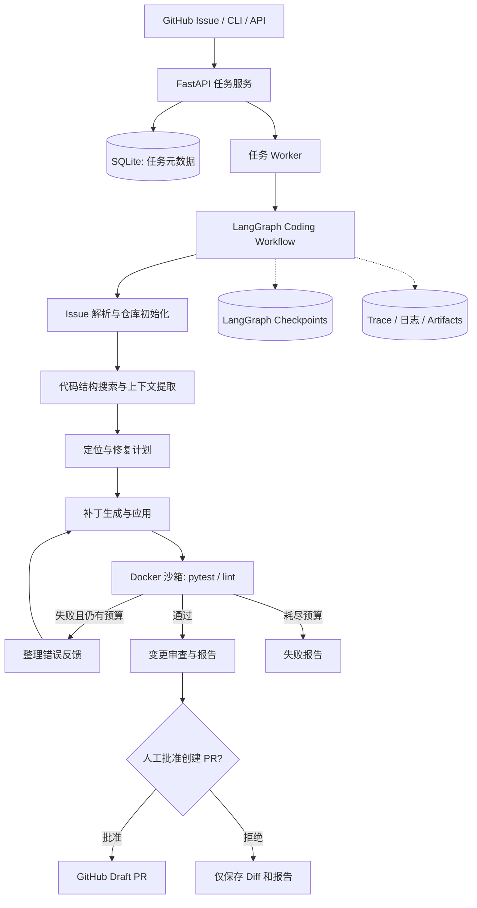

# 项目一：RepoPilot —— 企业级 Issue-to-PR Coding Agent

## 2. 业务背景与项目定位

### 2.1 真实业务问题

互联网公司的研发团队经常面对可以描述清楚、但需要跨文件理解和执行测试才能完成的维护任务，例如：

- 修复 Python API 服务中的输入校验问题；
- 修改公共函数后同步更新多个调用位置；
- 修复依赖更新导致的兼容性问题；
- 对已有代码进行缺陷修复并补齐回归测试；
- 阅读 CI 报错，定位失败文件并产出补丁。

这些任务通常涉及“找代码 → 分析原因 → 修改文件 → 执行测试 → 根据错误继续修复 → 人工审核”，适合 Agent 执行，但必须有清晰的验证边界。

### 2.2 MVP 业务场景

**用户故事：** 开发者为一个 Python 项目创建 Issue：

> “更新用户资料后，订单查询接口未正确返回新字段。请修复相关模块，补充回归测试，并生成供审核的代码变更。”

系统接到任务后自动：

1. 拉取指定的**白名单测试仓库**，为任务创建独立工作目录/分支；
2. 读取 Issue，搜索仓库、定位相关模块与测试；
3. 形成修复计划；
4. 修改代码并生成 Git diff；
5. 在 Docker 中执行测试；
6. 如失败，将错误摘要反馈到 Agent，再次尝试修复；
7. 达到完成条件或预算上限时停止；
8. 生成最终报告与 Draft PR（默认只对自己拥有的测试仓库创建 PR）。

**边界：** 第一版只支持 Python 仓库；不支持任意语言；不允许自动合并 PR、自动执行生产部署或操作未经授权的外部仓库。

## 3. 架构设计



### 3.1 建议模块划分

| 模块               | 职责                         | 你应独立实现的关键点                            |
| ------------------ | ---------------------------- | ----------------------------------------------- |
| Task API           | 创建/取消/查询任务、审批结果 | Task 状态机、参数校验、任务幂等性               |
| Repo Workspace     | 拉取仓库、创建分支、保存文件 | 工作区隔离、路径校验、清理机制                  |
| Repo Explorer      | 搜索文件、符号、调用关系     | `ripgrep` + Python `ast` 起步；上下文排序与压缩 |
| Coding Graph       | 分析 → 修改 → 测试 → 反馈    | 自定义 State、节点、路由、循环限制              |
| Tool Layer         | 读取、搜索、写入、Diff       | 工具参数验证、错误返回、操作日志                |
| Sandbox Runner     | 安全执行构建/测试            | 容器资源/时间限制、命令结果捕获                 |
| GitHub Integration | GitHub Issue/PR 操作         | Token 权限最小化、PR 审批、异常处理             |
| Evaluator          | 执行评测集并汇总             | 成功判定、成本/耗时统计、基线对比               |

### 3.2 LangGraph State 设计建议

不要把整个代码库放在 `State` 中。建议使用：

```text
CodingState
├── task_id, issue_id, repo_id, branch
├── task_spec, acceptance_criteria
├── relevant_file_paths, context_refs
├── plan, current_step, iteration_count
├── patch_ref, test_report_ref
├── status, last_error, needs_approval
└── model_usage, action_history_refs
```

**必须有的流程控制：**

- 单任务最多修复尝试次数，例如 3 次；
- 单任务最大工具调用次数和模型预算；
- 执行失败、模型超时、无效补丁、测试超时的独立处理分支；
- Checkpoint 与稳定 `thread_id`；
- 创建 PR 前人工 `interrupt`/审批；
- Git 推送、PR 创建等非幂等操作在恢复时需要去重，避免重复提交。

## 4. 功能开发范围

### 4.1 P0 —— 寒假实习简历必须有的功能

| 编号 | 功能                           | 验收方式                                   |
| ---- | ------------------------------ | ------------------------------------------ |
| C-01 | 接收 Issue 文本及目标 Git 仓库 | CLI/API 创建任务并能查询状态               |
| C-02 | 创建隔离工作区                 | 并发或连续任务互不污染、可自动清理         |
| C-03 | 代码搜索与上下文选择           | 能说明为何选中相关文件、能输出来源路径     |
| C-04 | LangGraph 工具调用循环         | 展示完整执行轨迹，错误可反馈给下一轮       |
| C-05 | 自动生成并应用 Patch           | 能保存实际 Diff，拒绝越界路径修改          |
| C-06 | Docker 中执行 pytest           | 记录退出码、超时、stdout/stderr 与测试摘要 |
| C-07 | 测试失败后自动尝试修复         | 限制迭代次数，超限能正常退出               |
| C-08 | 任务持久化与恢复               | 中断/重启 Worker 后能从检查点恢复          |
| C-09 | 生成报告与人工审核             | 输出问题、修改文件、测试结果、失败原因     |
| C-10 | 安全地创建 Draft PR 或导出补丁 | 审批后对自有测试仓库创建 PR；默认 dry-run  |
| C-11 | 自动化测试和评测脚本           | `pytest`、一键评测、结果 CSV/JSON          |

### 4.2 P1 —— 有余力再做的优化

- 更好的仓库理解：Python AST 符号索引、跨模块依赖图；
- 大型仓库上下文裁剪、摘要、缓存；
- 使用失败案例库进行检索辅助修复；
- 简单的 Streamlit 任务看板、流式输出；
- 多模型实验/成本路由（此时再引入 LiteLLM）；
- 与 GitHub Actions 真实 CI 状态联动。

**不作为 P0：** 自建向量数据库、复杂 RAG、语言服务器全量集成、全语言支持、自定义 IDE。

## 5. 技术方案与仓库选择

### 5.1 本项目最终使用

`Python 3.12`、`LangGraph`、`LangChain 模型适配器`、`FastAPI`、`Pydantic`、`Git CLI`、`Docker`、`SQLite`、`pytest`、`ruff`、`uv`。

前期代码检索先用 `rg`、文件路径与 Python `ast`。等准确率受到上下文限制时再考虑 tree-sitter 或 Embedding；不必第一天就构建复杂语义索引。

### 5.2 GitHub 参考与被测项目

| 仓库                         | 链接                                            | 用途                                              | 是否直接作为主框架            |
| ---------------------------- | ----------------------------------------------- | ------------------------------------------------- | ----------------------------- |
| mini-swe-agent               | https://github.com/SWE-agent/mini-swe-agent     | 学习 Agent 最简执行循环、工具与执行环境分离、评测 | **否**，自己用 LangGraph 实现 |
| OpenHands Software Agent SDK | https://github.com/OpenHands/software-agent-sdk | 参考事件模型、工作区、工具、安全执行、服务化架构  | 否                            |
| SWE-bench                    | https://github.com/SWE-bench/SWE-bench          | 参考真实 issue 修复任务和评测方式                 | 不直接把完整数据集作为 MVP    |
| httpx                        | https://github.com/encode/httpx                 | 真实 Python 项目候选测试对象                      | 候选                          |
| Typer                        | https://github.com/fastapi/typer                | 真实 Python 项目候选测试对象                      | 候选                          |

**建议先为自己维护的小型 Python 业务仓库注入已知 Bug，以确保完成闭环。** 之后再选择一个固定 Commit 的公开 Python 项目制作更复杂的评测任务；避免直接在公共仓库上产生无关 PR。引用/复用代码时检查项目许可证及归属说明。

## 6. 测试与验收标准

### 6.1 评测集设计

至少准备 **20 个独立任务**，按难度分层：

| 类别              |   数量 | 示例                              |
| ----------------- | -----: | --------------------------------- |
| 单文件明确缺陷    |      8 | 空值处理、边界条件、异常路径      |
| 跨文件/跨模块修改 |      6 | API 字段修改及调用方联动          |
| 回归测试补充      |      3 | 修复 Bug 并补充 pytest 测例       |
| 依赖/配置兼容性   |      3 | 版本变化引发的参数差异或测试失败  |
| **合计**          | **20** | 每项固定代码基线、Issue、期望断言 |

每个任务要有**隐藏验收测试**，避免 Agent 只通过自己看到的测试而错误宣告完成；记录任务原始 Commit SHA、环境、依赖版本与人工确认的标准结果。

### 6.2 核心量化指标

- **任务成功率**：通过隐藏验收测试的任务数 / 总任务数；另记模型自报“完成”率，不能混为一谈。
- **测试通过率**：完成后通过公开回归测试的任务数 / 总任务数。
- **修复尝试开销**：平均/中位尝试次数、模型 Token 消耗、API 成本。
- **任务耗时**：中位耗时与 P95；区分模型等待时间和 Docker 测试时间。
- **补丁有效性**：能够成功应用 Diff、未修改禁止路径的任务比例。
- **系统可靠性**：失败/超时/重启场景下任务是否能正确终止或恢复。

至少设置两个对照：**B0 基础 Agent**（相同模型/预算，简单顺序搜索与修改）、**B1 完整 RepoPilot**（增加结构化检索、测试反馈和状态恢复）。若时间允许，再做去掉结构化检索或去掉自动重试的消融实验。

### 6.3 P0 完成门槛（工程性硬标准）

- [ ] API/CLI 能在同一台机器上创建、执行、查询和终止任务。
- [ ] 至少 **5 个演示任务**能走通 Issue → 查找 → 修改 → 测试 → 报告 → 人工确认的全流程；每个任务都有可展示记录。
- [ ] 20 个评测任务全部有固定输入、隐藏测试和机器可读结果；如任务失败，应如实标记，不能丢弃失败样本。
- [ ] 测试失败后能重试且不会无限循环；断网、超时、模型错误有可控终态。
- [ ] Worker 重启后能正确恢复一个已暂停任务，并且不会重复创建 PR。
- [ ] 沙箱不能读取宿主机凭据、不能访问非白名单路径；默认禁止未经授权的外部仓库写入。
- [ ] 输出成功率、耗时、Token 成本，至少与一个基线进行同条件比较。
- [ ] `README.md`、架构图、启动脚本、测试脚本、演示视频或 GIF 齐全。

**期望性能目标（不是既有成果，也不是交付硬保证）：** 在自己维护、可控且测试明确的入门级缺陷任务上，争取自动完成率达到 60% 以上；更难的真实 Issue 任务不预先承诺数值。实际简历只写测出的数据，并提供评测口径。

### 6.4 演示脚本

1. 创建一个 Issue，展示任务进入队列。
2. 展示 Agent 检索 Python 项目、产生定位计划。
3. 故意提供会触发一次测试失败的用例，观察 Agent 自动反馈修复。
4. 展示 pytest 结果、Git diff、任务消耗统计。
5. 人工批准生成自己的测试仓库 Draft PR。
6. 演示失败任务也会正确终止并生成报告。